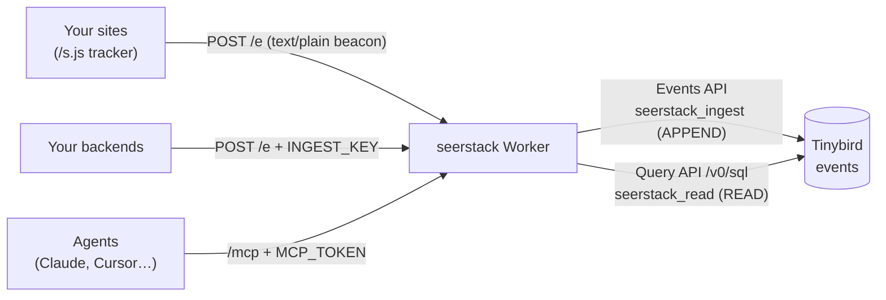

# Architecture

One Cloudflare Worker (Hono) in front of one Tinybird datasource. No UI and no database of its own.

## Routes (`src/index.ts`)

- `GET /s.js`: the tracker (`src/tracker.ts`). It sends pageviews on load and on `pushState`/`popstate`, and exposes `window.seerstack.track/identify`. No cookies or storage.
- `POST /e`: ingest. Takes one event, or `{ project, batch: [...] }` up to 500. The body is parsed as JSON whatever the Content-Type (beacons send `text/plain` to avoid a CORS preflight). `src/normalize.ts` validates and enriches events into rows.
  - Browser rows are written in `waitUntil`, and the response doesn't wait for them.
  - Server rows are awaited, so a Tinybird failure returns 502 and the caller can retry.
- `/mcp`: stateless Streamable HTTP MCP server (`src/mcp.ts`), with a fresh server per request. Auth is the `MCP_TOKEN` bearer header, or `?token=` for clients that can't set headers.

## Querying

- Prebuilt tools (`overview`, `timeseries`, `breakdown`, `list_events`, `funnel`, `list_projects`) are in `src/analytics.ts`. Each builds a Tinybird template: the SQL starts with `%`, and every value is a `{{String(pN)}}` placeholder that Tinybird binds from form params. Only allowlisted column names and validated integers are inlined.
- `run_sql` runs agent-written SQL. `src/sql-guard.ts` checks it (single SELECT/WITH, no SETTINGS/FORMAT/INTO/system tables/external table functions), then wraps it with caps of 10,000 rows, 10 s and 1 GB.
- Both use the `seerstack_read` token, which can only read `events`.

## Tinybird

- Datafiles: `tinybird/datasources/events.datasource` (Forward CLI, `tinybird.config.json` at the repo root).
- The datasource defines two static tokens: `seerstack_ingest` (APPEND) and `seerstack_read` (READ).
- Storage: MergeTree, partitioned by month, sorted by `(project_id, event, timestamp)`. Duplicates aren't collapsed.

## Config

- `wrangler.jsonc`: `TINYBIRD_HOST` (the workspace's region).
- Secrets: `TINYBIRD_INGEST_TOKEN`, `TINYBIRD_READ_TOKEN`, `INGEST_KEY`, `MCP_TOKEN`, `ANON_SALT`.
- Local dev reads `.dev.vars`, which points at Tinybird Local on `:7181`.
- Production: Worker `seerstack` at https://seerstack.com (custom domain; also https://seerstack.jp-814.workers.dev), Tinybird workspace `seerstack` (europe-west2). The generated `INGEST_KEY`, `MCP_TOKEN` and `ANON_SALT` are also kept in the gitignored `.env.production`.
