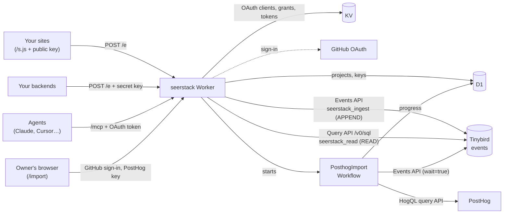

# Architecture

One Cloudflare Worker (Hono) at https://seerstack.com. Projects and imports live in D1, OAuth state in KV, and events in one Tinybird datasource. A Workflow imports history from PostHog in the background. The only UI is the OAuth consent page and the owner's PostHog import page.

## Routes

`src/index.ts` exports an `OAuthProvider`. Requests to `/mcp` with a valid token go to `mcpHandler`. The provider itself answers `/token`, `/register` and the `/.well-known/oauth-*` discovery documents. Everything else goes to the Hono app.

- `GET /s.js`: the tracker (`src/tracker.ts`). It sends pageviews on load and on `pushState`/`popstate`, and exposes `window.seerstack.track/identify`. It reads the public key from `data-key`. By default it stores nothing; with `data-persist` it keeps a random visitor ID in localStorage and sends it as `anonymous_id` (ADR 0008).
- `POST /e`: ingest. Takes one event, or `{ batch: [...] }` up to 500.
  - A bearer header means a server event: the key is resolved as a secret key.
  - Otherwise it's a browser event: the public key comes from `key` in the body, and the Origin must match the project's domains.
  - The body is parsed as JSON whatever the Content-Type (beacons send `text/plain` to avoid a CORS preflight). `src/normalize.ts` turns events into rows.
  - Browser rows are written in `waitUntil`. Server rows are awaited, so a Tinybird failure returns 502.
- `GET/POST /authorize` and `GET /callback`: OAuth sign-in for MCP clients (`src/auth.ts`).
  1. The consent page shows the client's name and where the token goes.
  2. Allow redirects to GitHub with PKCE.
  3. The callback completes only for `ALLOWED_GITHUB_USER_ID`.
  - The library's `beginConsent`/`approveConsent`/`beginUpstream`/`finishUpstream` bind each step to the browser.
- `GET/POST /import`, `GET /import/:id`, `POST /import/:id/cancel` and `GET /callback/import`: the owner's PostHog import page and its GitHub sign-in (`src/import-page.ts`, `src/sign-in.ts`). See Imports below.
- `/mcp`: a stateless Streamable HTTP MCP server (`src/mcp.ts`), with a fresh server per request. `mcpHandler` re-checks the GitHub ID in the token's props.

## Projects

`src/projects.ts` reads and writes the D1 `projects` table (`migrations/`). Public keys are stored as-is, secret keys as SHA-256 hashes. Key lookups on ingest are cached per isolate for 60 s.

## Querying

- Prebuilt tools (`overview`, `timeseries`, `breakdown`, `list_events`, `funnel`, and activity in `list_projects`) are in `src/analytics.ts`. Each builds a Tinybird template: the SQL starts with `%`, and every value is a `{{String(pN)}}` placeholder that Tinybird binds from form params. Only allowlisted column names and validated integers are inlined.
- `run_sql` runs agent-written SQL. `src/sql-guard.ts` checks it (single SELECT/WITH, no SETTINGS/FORMAT/INTO/system tables/external table functions), then wraps it with caps of 10,000 rows, 10 s and 1 GB.
- Both use the `seerstack_read` token, which can only read `events`.

## Imports

The owner starts an import on `/import` (`src/import-page.ts`): it signs them in with GitHub (`src/sign-in.ts`: the same GitHub OAuth App, returning to `/callback/import`, then a signed 12-hour session cookie scoped to `/import`, with a CSRF token in its forms) and takes the project and PostHog key, so the key never passes through an agent. The MCP tool `import_posthog` only returns a link to it. `startPosthogImport` (`src/imports.ts`) checks the PostHog key and range, counts the events, inserts a row in the D1 `imports` table and starts the `PosthogImport` Workflow (`src/import-workflow.ts`) with the import's ID as the instance ID, kept for a day after it finishes. The API key goes into the Workflow params sealed (`src/seal.ts`). `/import/:id` shows progress, refreshing until it's done, and can cancel. Each Workflow step reads one page from PostHog (`src/posthog.ts`), maps it to event rows, skips rows Tinybird already has for that time range, appends the rest with `wait=true`, and writes the totals and position to D1. Rate limits become `step.sleep`; auth and query errors end the import as failed. `list_imports` reads D1 and marks imports failed if their Workflow died without reporting; `cancel_import` terminates the instance. See ADR 0009.

## Tinybird

- Datafiles: `tinybird/datasources/events.datasource` (Forward CLI, `tinybird.config.json` at the repo root).
- The datasource defines two static tokens: `seerstack_ingest` (APPEND) and `seerstack_read` (READ).
- Storage: MergeTree, partitioned by month, sorted by `(project_id, event, timestamp)`. Duplicates aren't collapsed.

## Config

- `wrangler.jsonc`:
  - Bindings: `DB` (D1 `seerstack`), `OAUTH_KV`, and `IMPORTS` (the `seerstack-posthog-import` Workflow, class `PosthogImport`, exported from `src/index.ts`).
  - Vars: `TINYBIRD_HOST`, `GITHUB_CLIENT_ID`, `ALLOWED_GITHUB_USER_ID`.
  - Custom domain: `seerstack.com`.
- Secrets: `TINYBIRD_INGEST_TOKEN`, `TINYBIRD_READ_TOKEN`, `ANON_SALT`, `GITHUB_CLIENT_SECRET`.
- Production:
  - Cloudflare account jp@interface.london (the zone and the Worker).
  - Tinybird workspace `seerstack` (europe-west2).
  - GitHub OAuth App "Seerstack" with callback https://seerstack.com/callback.
  - `ANON_SALT` is also kept in the gitignored `.env.production`.
- Local dev reads `.dev.vars`, which points at Tinybird Local on `:7181`. Run `wrangler d1 migrations apply seerstack --local` first.
